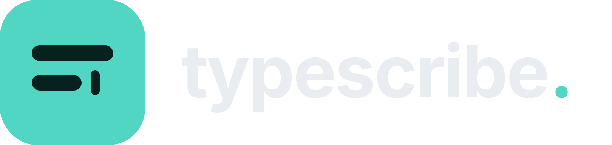

<p align="center">
  
</p>

<p align="center">Type along with videos you love.</p>

<p align="center">
  <a href="https://typescribe-type.vercel.app">Open Typescribe</a> ·
  <a href="https://github.com/mtellami/typescribe/releases">Releases</a> ·
  <a href="docs/development.md">Development guide</a>
</p>

Typescribe turns YouTube videos into typing and listening practice. Pick a video,
follow its captions, and build your rhythm one line at a time.

## Four ways to practice

| Mode      | How it works                                                                                   |
| --------- | ---------------------------------------------------------------------------------------------- |
| **Type**  | Type along with visible captions. Practice every word, fewer words, or just the first letters. |
| **Fill**  | Complete two missing words, then read the next word for context.                               |
| **Write** | Listen and type the hidden captions, with letter hints when you need them.                     |
| **Watch** | Follow the full transcript as the video plays. Click a line to jump to it.                     |

## Features

- **Your videos, your practice.** Preview a YouTube link before adding it, or pick a video from Recent and Library.
- **Feedback as you type.** Track words per minute and accuracy, then review your session summary.
- **Practice at your pace.** Adjust playback speed, replay a caption, and switch between video and text layouts.
- **Make it comfortable.** Choose a practice font, use a custom Google Font, and customize key and error sounds.
- **Accounts when you need them.** Practice publicly, or sign in with Google or email to import videos and access Library and Settings.
- **Preferences that stick.** Font, layout, sounds, and typing preferences are saved on your device.

## Get started

1. [Open Typescribe](https://typescribe-type.vercel.app) and browse the video library.
2. Choose a video, or sign in and paste a captioned YouTube link into **Select video**.
3. Pick a practice mode and start typing or listening.

### Keyboard shortcuts

| Shortcut        | Action                                          |
| --------------- | ----------------------------------------------- |
| `Tab`           | Replay the current caption                      |
| `Shift` + `Tab` | Go to the previous caption                      |
| `Enter`         | Go to the next caption                          |
| `Ctrl` + `H`    | Reveal the next letter                          |
| `Backspace`     | Correct your input, including the previous word |

Shortcuts apply while the typing input is focused. Fill and Write also have a
**Hint** button.

## Run locally

With Docker Compose and Make installed:

```sh
git clone https://github.com/mtellami/typescribe.git
cd typescribe
make up
```

Open [localhost:3000](http://localhost:3000). This starts the app with hot reload
and PostgreSQL, applies database migrations, and creates `infra/.env` on first
run. Configure a Supadata API key there to import new videos. Google sign-in is
optional and needs your own OAuth credentials.

Use `make logs` to follow logs and `make down` to stop the app while preserving
the database.

See the [development guide](docs/development.md) for host setup, authentication,
environment variables, testing, and deployment.

## Project

```text
app/       Application, tests, dependencies, and database migrations
infra/     Local Docker and environment configuration
docs/      Development guide and README assets
```

## Releases

**[v1.0.0](https://github.com/mtellami/typescribe/releases/tag/v1.0.0)** is the
first official release. See the [changelog](CHANGELOG.md) for release notes.

## License

Application code is available under the [MIT License](LICENSE).
